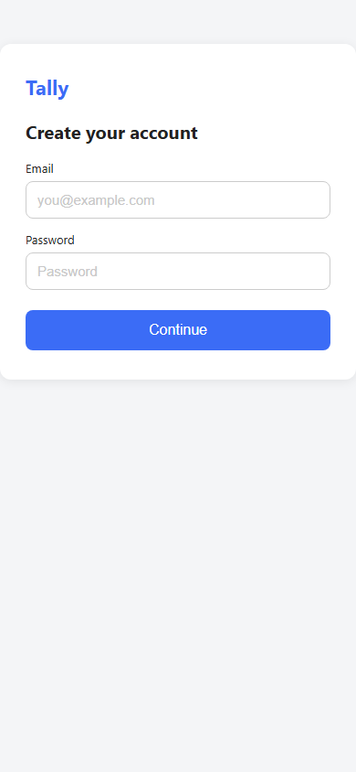

# /ux-strategy — UX audit for the screen you built: what to fix first

**When you've built a screen or flow (for example with Claude Code) and aren't sure it's easy to use, give it the screenshots and get the 3 fixes chosen by a UX audit (Nielsen heuristic evaluation with severity 0–4, checked against the user's main task), why each matters, and fix instructions you can paste back into Claude Code. Ask for more and you get the full audit or a UX strategy: information architecture, user journeys, and priorities.**

## Example

Input: three screenshots of a mock signup flow for a habit-tracking app, and *"What should I fix first?"*

| Step 1 | Step 2 | Step 3 |
|---|---|---|
| [](examples/signup-step1.png) | [](examples/signup-step2.png) | [](examples/signup-step3.png) |

Output (quoted from the run, shortened to fit):

```text
1. Step 2 (Tell us about you) — Phone number asked before the user has seen any
   product value, with no reason given.        Nielsen H2 + H10 · Severity 4
2. Step 3 (Turn on notifications) — Permission asked before any habit or
   reminder exists.                            Nielsen H1 + H10 · Severity 4
   Fix instruction for Claude Code:
   > Delete the standalone "Turn on notifications" step from signup. After the user
   > creates their first habit and picks a reminder time, show the native OS
   > permission prompt from that screen, preceded by one line: `Allow notifications
   > so Tally can remind you at <reminder time> to <habit name>.` Keep a `Not now`
   > option that leaves the habit saved without reminders.
   > Check: A new user can finish signup without seeing a notification prompt; the
   > prompt only appears after they save a habit with a reminder.
3. All 3 screens — No progress indicator, so the user doesn't know how many steps
   are left.                                   Nielsen H1 · Severity 3

Next: validate with 5 people who have never used Tally, thinking aloud.
Want the full audit or a strategy? Say "Audit" or "Strategy".
```

**How the 3 were chosen:** a heuristic evaluation against Nielsen's 10 usability heuristics, each problem rated on the NN/g severity scale (0–4) by how much it blocks the user's main task, then ordered by severity and by how early it appears in the flow. Method definitions and sources: [`references/ux-methods.md`](references/ux-methods.md).

Full answer, run settings, and a side-by-side with plain chat on the same screenshots: [examples/signup-audit.md](examples/signup-audit.md). The app and page are fictional mocks.

## Install

**Option A — via the [skills CLI](https://github.com/vercel-labs/skills):**

```bash
npx skills add laymom/consulting-ux-strategy --skill ux-strategy
```

This copies `SKILL.md` together with `references/` (the methods file the skill reads first). For Claude Code at project level it lands in `./.claude/skills/ux-strategy/`.

**Option B — manual clone (user-level, all projects):**

macOS / Linux:

```bash
git clone https://github.com/laymom/consulting-ux-strategy.git ~/.claude/skills/ux-strategy
```

Windows (PowerShell):

```powershell
git clone https://github.com/laymom/consulting-ux-strategy.git "$HOME\.claude\skills\ux-strategy"
```

**First run:** start a new Claude Code session, save screenshots of your screen in the project folder, and type `/ux-strategy` with your question.

## Copy-paste input

```text
/ux-strategy I built this checkout flow (screenshots: cart.png, address.png, pay.png).
What should I fix first?
```

Screenshots work best. Code alone also works, but then it says it read only the code and makes no claims about how the screen looks. Mentioning who uses the screen and what they're trying to do sharpens the result; without it, the skill states the task it assumed. The answer is written in the language of your input.

## What you get (Quick fix, the default)

- **Top 3 fixes, on one screen.** Each says where (screen and element), what goes wrong for the user, why (the usability heuristic it breaks, severity 0–4 with a reason, a source link), and an evidence label.
- **A fix instruction for Claude Code** per problem: the concrete change, new wording where wording is the fix, and a check for when it's done. The three fixes are written to work together.
- **The problems a code review won't catch** come first: the next action isn't visible, a choice's meaning is unclear, information is asked for at the wrong moment, there's no feedback or sense of progress, wording users won't understand, errors that punish the user.
- **One cheapest way to validate** the fixes (e.g. 5 people trying the task while thinking aloud).

It doesn't ask questions first and doesn't edit your code; it reports, and you decide what to paste.

## Want more depth?

Ask for it by name ("Audit", "Strategy") or describe the job:

| Mode | When | You get |
|---|---|---|
| **Quick fix** (default) | You give a screen or flow and ask what to fix | Top 3 fixes with fix instructions |
| **Audit** | You want every issue on existing screens or key flows | Full issue list: where observed, problem, expected impact, principle, severity with reason, fix, how to validate; a cognitive walkthrough; priorities |
| **Strategy** | You're deciding IA, journeys, and priorities for a product or feature | A strategy doc: direction, information architecture, journey, priorities |
| **Full** | You ask for end-to-end work, such as a new MVP | All five steps below |

Audit and Full stop twice for your OK; Strategy usually skips step 4, so it stops once:

```text
1. Frame the problem (SCQA) and agree on metrics or user tasks   [your OK]
2. Structure it (issue tree, MECE, Day-1 hypotheses)
3. Understand users (JTBD, empathy and journey maps, IA)
4. Diagnose (Nielsen heuristics, severity 0–4, cognitive walkthrough)   [your OK]
5. Prioritize, recommend (answer first), name the next validation, hand off
```

**Audit** — from a full run on the same signup mock (quoted, shortened with …):

> **F1 — Password field wiped on validation failure (Severity 4)**
> - Where: `signup-mock.html:87` — `document.getElementById('pw').value = '';` runs on any password rule miss. Inspected via DOM/JS.
> - Task: T1. Problem: User's first attempt fails a strict rule (≥10 chars, uppercase, digit, symbol) and the field is emptied; they must retype from scratch. …
> - Expected impact: Perceived hostility at the first interaction; mobile users typing on soft keyboards hit hardest. May contribute to T1 attrition; validate.
> - Principle: H5 Error prevention, H9 Error recovery — https://www.nngroup.com/articles/ten-usability-heuristics/
> - Severity reason: Blocks the first task for likely most users, high persistence, trivially avoidable.
> - Fix: Preserve the input, show a show/hide toggle, and surface rules on focus (fixes F2 at the same time) with a live checklist.
> - How to validate: 5-user think-aloud pre-launch (count attempts to pass Step 1); post-launch, log Step 1 attempt counts.

That is one of 16 findings; the run also has a cognitive walkthrough, an Impact/Effort 2x2, and a validation plan: [examples/signup-audit-full.md](examples/signup-audit-full.md).

**Strategy** — from a run on a product brief for a fictional habit app, with no screens yet (quoted, shortened with …):

> **Lead sentence:** *Tally should win Day-7 retention by making the first log unavoidably easy, re-surfacing exactly once a day on the user's terms, and treating a missed day as nothing — and should ship nothing in v1 that fights those three.*
> …
> ```text
> Tally
> ├── Today            ← default surface on open; today's habit(s), log control, yesterday-editable strip
> ├── Habits           ← list, add/edit, pause (max 3 in v1)
> └── Me               ← reminder time, notifications on/off, data export, account
> ```
> …
> Day 4 (illustrative miss) and day 0 (the first ask) are plausible low points in this hypothetical journey; they are where B1 and B3 intervene. Validate with real users. [AI assumption]

The full document also has the SCQA framing, an issue tree, JTBD, the hypothetical first-week journey map, an IA validation plan (card sort, tree test), and a 2-month plan: [examples/strategy-tally.md](examples/strategy-tally.md).

## How it differs from asking in plain chat

Measured on the same three screenshots, once with the skill and once without ([comparison](examples/signup-audit.md#compared-with-plain-chat-same-screenshots-no-skill)):

- **Both** found the same top two problems. Plain chat was shorter and named a trade-off the skill didn't.
- **Only the skill** gave paste-ready fix instructions with exact wording and a done-check, kept the three fixes consistent with each other, raised a third problem (no progress indicator), and tied each problem to a heuristic, a severity with a reason, and a source.
- **Claims stay claims.** A screen review isn't behavior data, so the skill is told not to state drop-off or conversion effects as facts, and every claim carries one evidence label: **User-provided fact**, **Sourced fact**, **Real user research**, **AI assumption**, **Synthetic persona response**, **Approved decision**, or **Open question**.

## Limits · compatibility

- **It does not replace testing with real users.** It recommends tests; your team runs them.
- **One AI reviewer.** A heuristic evaluation normally uses 3–5 evaluators ([NN/g](https://www.nngroup.com/articles/how-to-conduct-a-heuristic-evaluation/)); this is a single pass, and severity is a judgment.
- **It sees what you give it.** Screenshots don't show error messages, validation rules, or later screens unless you include them; code doesn't show how the screen looks.
- **Synthetic input stays synthetic.** Maps built from simulated persona responses are labeled "hypothetical (synthetic input)".
- **Accessibility:** if it comments on accessibility, it states the scope and tool used. It is not a WCAG certification.
- **No mockups.** It produces findings, fix instructions, and documents, not visual designs.
- **Compatibility:** tested in Claude Code only. The skills CLI can install `SKILL.md` for other agents, but running it there is untested.

**Optional batch agent (Claude Code only).** `agents/ux-strategist.md` runs the same modes without stopping, for another workflow to call or to run several lenses in parallel. It runs as a separate subagent, so it uses more of your usage. You don't need it for normal use, and neither install option activates it:

macOS / Linux:

```bash
mkdir -p ~/.claude/agents
cp ~/.claude/skills/ux-strategy/agents/ux-strategist.md ~/.claude/agents/
```

Windows (PowerShell):

```powershell
New-Item -ItemType Directory -Force "$HOME\.claude\agents" | Out-Null
Copy-Item "$HOME\.claude\skills\ux-strategy\agents\ux-strategist.md" "$HOME\.claude\agents\"
```

(If you installed with Option A, copy from `./.claude/skills/ux-strategy/agents/` instead.) The agent looks for the skill files at the path given in its brief, then `./.claude/skills/ux-strategy/`, then `~/.claude/skills/ux-strategy/`.

## Related tools

Small, independent tools by the same author. Use any of them on its own; none requires the others.

- [multi-agent-brainstorm](https://github.com/laymom/multi-agent-brainstorm) — explore and compare ideas from 5 perspectives
- [synthetic-focus-group](https://github.com/laymom/synthetic-focus-group) — explore reactions and risky assumptions with simulated personas
- [ai-prd-generator](https://github.com/laymom/ai-prd-generator) — turn an idea into a PRD with scope and acceptance criteria
- [consulting-ux-strategy](https://github.com/laymom/consulting-ux-strategy) — find what to fix first in a screen you built, or run a full UX audit or strategy

When passing output between them, keep the evidence labels. Simulated persona responses stay labeled as synthetic in every downstream document.

## Methods · sources · license · changelog

- Methods: Nielsen's heuristics and severity scale and the cognitive walkthrough (NN/g), Double Diamond (UK Design Council), JTBD (Christensen), issue trees and MECE, the Pyramid Principle (Minto), HEART (Google), RICE (Intercom). Definitions and links: [`references/ux-methods.md`](references/ux-methods.md) (links checked 2026-10-12; links marked "secondary explainer" are not from the original author)
- License: MIT — see [LICENSE](LICENSE)
- Changes: [CHANGELOG.md](CHANGELOG.md)

Repository layout:

```text
SKILL.md                    # the skill (/ux-strategy)
references/ux-methods.md    # method definitions, scales, sources
references/handoff-map.md   # what comes before and after this skill
agents/ux-strategist.md     # optional batch agent (Claude Code only)
examples/                   # real runs: screenshots, Quick fix, plain-chat baseline, full Audit, Strategy
```

Built by **Sophia in Korea — a non-engineer who ships agents anyway.**
